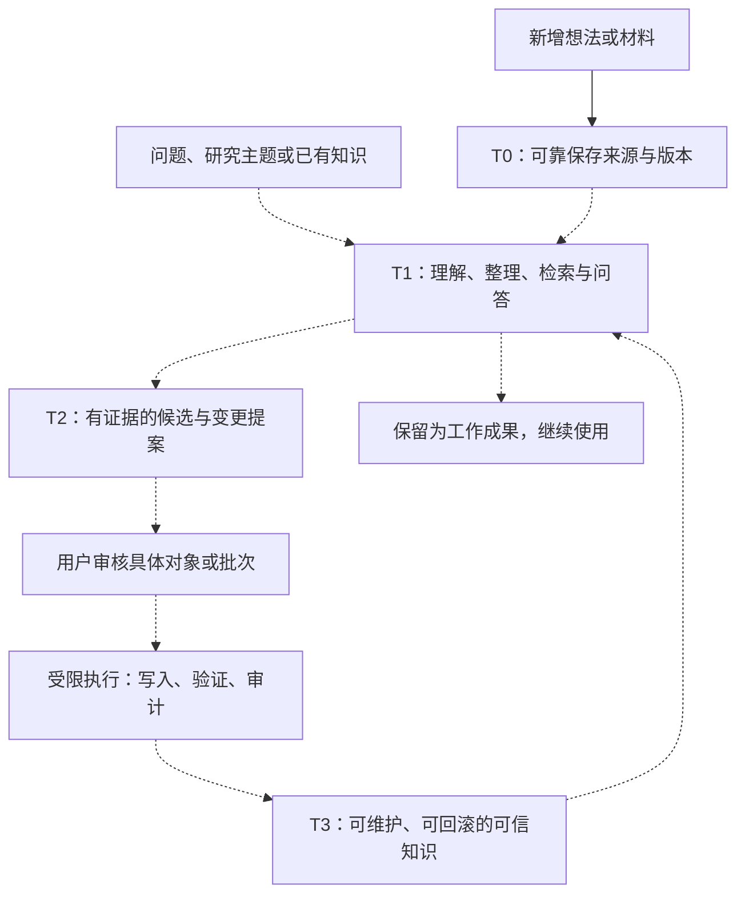

我已经把主需求文档、当前状态、捕获与路由契约、核心源码、提示词、测试和验收材料交叉核对了一遍。下面以你**当前工作区截至 2026 年 10 月 10 日的内容**为准，包含正在修订的文档。

先给出最重要的判断：**KnowledgeFlow 的最终目标，是一个能够帮助个人保存、理解、整理、检索和持续维护知识的系统；目前已经完成的主要是可靠的本地文本捕获与恢复底座，以及最小桌面收件箱。** AI 提炼、研究问答、知识图谱、知识库路由和可信 Wiki 写入，已经有不同程度的需求与设计，但还没有形成完整产品闭环。

这里需要区分三个状态：

| 状态 | 在这个项目里意味着什么 |
|---|---|
| 已实现、已验收 | 对应代码已经存在，并在明确范围内有测试或实际使用证据 |
| 设计已批准 | 产品义务或行为边界已经确认，具体功能可能仍未编码 |
| 草案或实验假设 | 还需要通过材料实验、技术比较或产品决策确定 |

当前动态状态以[项目状态文档](C:/Users/94233/knowledge-flow/docs/project-status-项目状态与当前门禁.md)为准，完整产品需求以[主 PRD](C:/Users/94233/knowledge-flow/docs/requirements-and-governance-baseline-需求与治理基线.md)为准。

**从产品定位看，它要降低的是“从接触材料到真正能够使用知识”的总成本。**

这个成本包括很多工作：保存原文、判断重点、理解陌生概念、比较不同来源、寻找证据、组织笔记、建立关联、更新过时内容，以及纠正以前的判断。

项目关注的一个核心矛盾是：高质量整理需要领域理解，但用户往往正因为不了解领域，才希望借助知识工具和 AI。如果让用户先把资料读懂、分类、建好知识库再开始，前置负担会很重；如果完全交给模型直接生成最终知识，又容易出现看似完整、实际遗漏或误解的问题。

KnowledgeFlow 准备把责任这样分配：

- **系统承担大部分可委托劳动**：保存、检索、阅读辅助、摘要、比较、聚类、关系发现、证据整理和变更准备。
- **用户决定目标和重要取舍**：现在研究什么、哪些结论值得保留、怎样组织长期知识，以及是否接受高影响变化。
- **执行组件负责准确落地**：按照已经确定的规则或已经批准的具体内容写入，验证结果，并留下审计和恢复依据。

因此，“用户控制最终决定”不意味着用户必须逐条手工完成整理。目标是让系统先把证据、差异和影响准备好，让用户能够按批次审核，并把注意力集中在关键判断上。

最终应该获得的效果，可以归纳为下面这些产品要求：

| 产品要求 | 用户最终能够获得什么 |
|---|---|
| 低摩擦捕获 | 灵感、笔记和资料先保存，不必先决定标签、领域和知识库 |
| 保存后可用 | 材料能够找回、浏览、搜索，并显示当前处理状态 |
| 陌生领域学习 | 通过概览、术语解释、争议、学习路径和追问逐步理解 |
| 零散内容整理 | 系统帮助汇总、分组、发现相似项，减少日常整理劳动 |
| 大型语料访问 | 先检索相关证据，再针对高价值部分加深处理 |
| 已有知识维护 | 自动准备新增、重复、冲突、过时和结构差异的分析 |
| 证据追溯 | 摘要、回答、关系和候选结论能够返回具体来源版本与原文 |
| 持续治理 | 长期知识可以编辑、重组、迁移、废弃和回滚 |
| 适应不同领域 | 不要求所有内容采用固定分类树、本体或 Wiki 模板 |
| 保留用户控制 | 普通变化可以批量审核，高影响变化能够精确批准 |

项目还明确提出：用“首次获得有用结果的时间、理解和整理收益、人工审核负担、证据正确性”衡量成功。当前尚未冻结这些指标的数值目标，需要先建立真实使用基线。

**它面向的使用场景，比单纯“收藏资料后生成 Wiki”更宽。**

现行需求定义了四类代表旅程：

| 使用场景 | 典型输入 | 系统预计提供的第一成果 |
|---|---|---|
| 日常知识管理 | 灵感、短笔记、计划、对话片段 | 可靠保存、可找回，以及按授权生成的整理建议 |
| 陌生领域研究与学习 | 一个问题、研究主题、尚未读懂的材料 | 有来源的概览、答案、术语和学习路径 |
| 熟悉领域与已有知识库维护 | 新材料、已有页面、明确修改目标 | 新旧内容对比、冲突分析和可审核变更 |
| 大型或持续增长语料 | 大量文档、持续流入内容 | 可追溯检索、证据包和局部理解 |

这几种场景可以互相转化。例如，随手保存的想法可以成为研究主题，研究成果可以逐渐形成长期知识库，已有知识库也可以重新进入研究和重构过程。

用户还可以直接针对已有材料提问。此时预计复用已有来源身份与版本，不必为了满足流程而再保存一份重复材料。

**理解整个架构时，最关键的是四层信任模型。**

| 层级 | 保存什么 | 这层内容的含义 |
|---|---|---|
| **T0：来源事实** | 原始文本、不可变版本、来源信息、哈希、用户明确意图 | 能证明用户提交过什么，不能证明材料中的观点正确 |
| **T1：工作知识** | 索引、摘要、提纲、问答、临时集合、候选图谱 | 可以帮助阅读和使用，但尚未成为用户接受的长期知识 |
| **T2：候选与提案** | 策展地图、路由建议、结构建议、精确变更方案 | 等待用户接受、修改、拒绝或延期 |
| **T3：可信知识与治理** | 获批知识内容、稳定结构、可信关系、批准和检查点 | 已经过明确治理，可持续维护、验证和回滚 |

这里的“可信”指取得了明确的产品治理身份，并不代表系统保证绝对正确。

目标架构可以这样理解，虚线部分主要仍处于规划或实验阶段：



一次问答、一份研究地图，或者只保留来源，都可以是任务的正确终点。需求没有要求每份材料最终都变成 Wiki 页面。

**主要功能模块可以整理成以下这张表。**

| 模块 | 主要职责 | 当前情况 |
|---|---|---|
| 本地捕获内核 | 保存文本、分配身份、生成版本、校验哈希、返回回执 | 已实现、已验收 |
| Capture 读取与浏览 | 读取当前或指定版本、稳定列表、分页、正文预览 | 已实现；完整搜索尚未实现 |
| 版本追加 | 保存完整新版本，处理重试和并发冲突 | 已实现；历史浏览界面待实现 |
| 最小桌面收件箱 | 新建、列表、阅读、续写、显示保存状态与错误 | Tk 界面已实现 |
| 存储管理与恢复 | 初始化、校验、备份、恢复、派生状态重建、迁移 | 当前限定范围已实现 |
| 任务与研究工作空间 | 从问题、材料、主题或模糊意图组织一次知识工作 | 顶层需求已确认，详细契约待设计 |
| 处理策略与调度 | 选择处理深度、控制范围、成本与触发条件 | 方法仍需实验；调度器未实现 |
| 来源分段与处理台账 | 记录处理了哪些区段、哪些延期、失败或未处理 | 概念与红线已明确，尚未实现 |
| 证据与候选知识 | 为结论绑定来源版本和可回读原文位置 | 当前核心实验方向，尚未实现 |
| 检索、问答与学习辅助 | 查找证据、生成答案、概览、解释与学习路径 | 需求已确认，技术方案待验证 |
| 组织与图谱 | 集合、标签、时间线、Wiki、分类、本体和关系图 | 长期需求已确认，详细设计待完成 |
| 人工路由与知识库生命周期 | 决定材料归属，创建临时 KB，后续激活 | 路由未实现；临时骨架有已批准设计 |
| 审核与可信写入 | 审核精确对象、执行获批变更、验证和回滚 | 执行闭环待设计，旧写入提示词暂停 |
| 知识维护 | 检查重复、冲突、过时、断链和结构漂移 | 旧 Markdown 维护脚本已存在；完整维护流程待实现 |
| 外部入口与适配器 | URL、文件、音频、QQ、GBrain、远程和多设备 | 可选扩展，尚未接入当前产品主线 |

这说明项目已经有较完整的顶层产品范围，但不少长期功能仍处于“需求已确认，详细流程、交互或数据契约待补齐”的阶段。

**目前真正运行起来的核心流程，是四个公共文本操作。**

对应代码集中在 [operations.py](C:/Users/94233/knowledge-flow/src/knowledgeflow_capture/operations.py:4173)，公共请求类型在 [models.py](C:/Users/94233/knowledge-flow/src/knowledgeflow_capture/models.py)。

| 操作 | 用途 | 关键特点 |
|---|---|---|
| `capture_text` | 创建一条新的文本记录 | 返回稳定身份、首个版本和保存回执 |
| `get_capture` | 读取最新或明确指定的版本 | 校验目标正文后输出完整内容 |
| `list_captures` | 浏览记录 | 固定排序、受限过滤、游标分页和机械预览 |
| `append_capture_version` | 为已有记录追加版本 | 保存完整新正文，要求明确版本基线与幂等键 |

一次新文本保存，大致按以下顺序执行：

1. **验证输入和运行环境。** 检查文本或 UTF-8 流、渠道元数据、本地配置、Store 身份和路径条件。保存不要求先选择 KB，也不等待模型、网络、Git 或 GBrain。

2. **建立本次事务的暂存区。** 暂存区与最终数据位于同一文件系统，并带有事务所有权信息与活动租约，供后续安全识别崩溃残留。

3. **分块写入原文。** 写入时计算实际字节数和 SHA-256，同时检查编码与大小。文本保留输入字符和换行，不进行自动修辞、裁剪或 Unicode 规范化。

4. **建立请求指纹。** 指纹描述本次提交的内容、渠道和明确意图，供重试时判断是不是同一个请求。

5. **取得 Store 写锁，检查幂等身份。** 如果同一个重试键对应已经提交的相同请求，返回原身份和原版本；如果同一个键被用于不同请求，返回幂等冲突。

6. **生成稳定身份与机器记录。** 幂等未命中后，生成 Capture ID 和 Event ID，写入正文清单、Envelope 和创建事件。

7. **刷新、回读并验证后提交。** 文件写入经过 `flush`、`fsync` 和回读校验，再通过同盘、不覆盖目标的原子重命名，把完整 Item 放入最终位置。提交后再次验证最终事实。

8. **更新当前状态投影并返回结果。** `capture.yaml` 记录当前状态。如果原文、Envelope 和事件已提交，但状态投影更新失败，返回保存成功与重建警告，保留已经成立的提交事实。

这是一套有明确提交点和恢复语义的文件事务设计。

当前文本边界也定义得比较细：

- 真正的空字符串会被拒绝。
- 非空的空格或换行允许保留。
- 开头的 BOM、非法 UTF-8 会被拒绝，不静默清洗。
- 默认内联传输阈值为 **4 MiB**，它不是存储上限。
- 单文本版本默认安全上限为 **64 MiB UTF-8 字节**，可通过本机配置调整。
- 大文本仍是一份完整正文，不按传输块拆成多条 Capture。

**“追加版本”保存的是完整新快照。**

例如，原记录为：

```text
Capture A
  v1：最初保存的完整文本
  v2：修改后的完整文本
  v3：再次修改后的完整文本
```

旧版本继续保留，每个版本都有自己的正文、Envelope、哈希和对应事件。

追加请求必须带上 `expected_current_version`。这表示调用方知道自己基于哪个版本修改：

```text
你读到 v2，准备保存 v3
与此同时，另一个会话已经保存了 v3
你的请求仍声明“基于 v2”
→ 返回 version_conflict，保留草稿，由你重新核对
```

它采用的是比较并交换，也就是常说的 CAS。当前不会静默覆盖，也不会自动合并两份修改。

追加还有一个重要的提交边界：

```text
新版本目录写入最终位置
    ↓
对应追加事件提交
    ↓
新版本才取得逻辑可见性
```

因此，崩溃留下一个新版本目录，并不代表那个版本已经成功提交。读取时依据连续的版本与事件链判断当前版本，不能仅看最大的目录编号。

同一追加请求成功后再次重试，会先检查幂等命中，再处理版本竞争，从而避免因为当前版本已经前进而重复生成新版本。

**读取、列表与完整校验承担的职责不同。**

`get_capture` 可以读取最新版本，也可以明确读取 `version=N`。它验证版本链、Envelope、事件引用和目标 Payload 的完整哈希，再输出正文。

`list_captures` 更偏向浏览：

- 固定按照 `captured_at DESC, capture_id DESC` 排序。
- 支持时间范围和当前受支持的路由状态过滤。
- 使用绑定 Store 身份与查询条件的游标分页。
- 提供当前正文前 160 个 Unicode code point 的机械预览。
- 核心默认每页 50 条，最大 100 条；收件箱默认每页 25 条。

为了控制浏览成本，列表不会逐份重新计算所有大正文的完整哈希。正文完整校验主要由明确读取和管理校验承担。

当前列表也没有全文搜索、语义搜索、标签筛选或模型排序。这些属于后续工作知识与检索模块。

**保存结果被分成三种状态，这是恢复逻辑的基础。**

| 提交状态 | 含义 | 调用方应该如何处理 |
|---|---|---|
| `committed` | 最终版本与事件已被验证为提交 | 可以报告保存成功 |
| `not-committed` | 可以证明本次未提交 | 保留输入，修正原因后再提交 |
| `unknown` | 在故障边界无法证明最终结果 | 保留原请求和原幂等键，核对或安全重试 |

桌面收件箱针对 `unknown` 会保留当前请求身份，并限制用另一份正文替换它。用户可以重试原请求，或者先刷新、重读，再明确放弃待核实请求。

这些请求身份和未保存草稿目前只存在于当前进程内。关闭或崩溃后不会自动重发，草稿也没有持久化保证。

**底层数据模型围绕“原件、版本、事件和可重建状态”展开。**

简化后的 Store 结构如下，省略了一些预留目录：

```text
<capture-root>/
├── capture-store.yaml              Store 身份与布局版本
├── items/
│   └── YYYY/MM/<capture-id>/
│       ├── capture.yaml            可重建的当前状态投影
│       ├── versions/
│       │   ├── 000001/
│       │   │   ├── envelope.yaml   版本元数据、来源、意图、哈希
│       │   │   └── payloads/
│       │   │       └── primary.txt 原始正文
│       │   └── 000002/
│       │       └── ...
│       └── events/
│           └── <event-id>.yaml      追加式事件记录
├── .staging/                       事务暂存区
├── journal/                        写锁等运行协调文件
├── indexes/                        可重建索引的预留位置
└── outbox/                         可重建投递状态的预留位置
```

这里需要注意：

- `versions/` 内的版本通过产品接口保持不可变。
- `events/` 保留版本成立的审计依据。
- `capture.yaml` 是投影，损坏后可以从规范事实重建。
- 当前索引和 outbox 目录的存在，不代表检索引擎或异步任务系统已经实现。
- 当前 `delivery_requests` 固定为空，也不会自动投递到 GBrain。

此外，代码已经可以记录 `target_kb_id`、`processing_mode` 等明确意图，但 MVP-0 不实际执行 KB 路由或语义处理。**字段存在与功能执行需要分别判断。**

**存储管理与日常业务操作是两个独立入口。**

项目提供三个安装入口，定义在 [pyproject.toml](C:/Users/94233/knowledge-flow/pyproject.toml)：

| 入口 | 用途 |
|---|---|
| `knowledgeflow-capture` | 面向程序调用四个公共文本操作 |
| `knowledgeflow-capture-admin` | 显式执行 `init / verify / backup / restore` |
| `knowledgeflow-inbox` | 启动最小 Tk 桌面收件箱 |

初始化、修复或恢复不会被界面静默触发。

管理和恢复能力又可以细分为：

| 能力 | 当前逻辑 |
|---|---|
| 初始化 | 在明确位置创建或幂等重开 Store，建立身份和配置 |
| 校验 | 在写锁范围内完整验证存储，不顺便修复 |
| 崩溃残留恢复 | 只清理能证明由本系统拥有且已经放弃的暂存事务 |
| 派生状态重建 | 先验证不可变事实，再重建状态投影和允许的派生目录 |
| Store 迁移 | 验证源、复制、验证目标，再原子切换配置，保留源 |
| 备份 | 创建有严格文件清单与哈希的 Backup Bundle |
| 备份恢复 | 恢复到全新目标，验证等价性，不自动切换活动配置 |

备份包含 `backup.json` 和 `capture-store/`。清单在副本验证完成后最后写入，用来证明文件集合、大小与哈希。

恢复目标必须此前不存在。失败留下的部分目标会保留，不自动覆盖或续传；重试需要选择新目标。

当前备份声明为 `operational-copy`：它已有副本完整性和恢复证据，但没有证明异盘灾备或正式高敏内容环境就绪。

对应实现主要在 [management.py](C:/Users/94233/knowledge-flow/src/knowledgeflow_capture/management.py)、[recovery.py](C:/Users/94233/knowledge-flow/src/knowledgeflow_capture/recovery.py) 和 [migration.py](C:/Users/94233/knowledge-flow/src/knowledgeflow_capture/migration.py)。

**在未来的知识处理流程里，三条价值线路共享证据底座，但可以采用不同处理方法。**

这三条线路是：

| 价值线路 | 主要目标 | 预计成果 |
|---|---|---|
| 低摩擦批量整理 | 减少零散笔记的日常整理负担 | 批次概览、主题分组、相似项、整理建议 |
| 深入策展 | 帮助理解用户选定的中长篇高价值材料 | 概览、结构地图、重要主张、争议、缺口、学习路径 |
| 检索优先 | 让大型或持续增长语料能够按问题使用 | 检索结果、Evidence Bundle、局部答案与候选 |

它们共享的基础链路预计是：

```text
精确 Capture 版本
→ 可重建的来源区段
→ 明确的处理范围与缺口
→ 证据定位
→ 打开对应版本的原文
```

涉及几个关键概念：

- **Source Segment**：按确定性规则切分出来的来源区段，具有可复现的顺序、范围和身份。
- **Source Ledger**：处理台账，显示哪些区段已索引、已概览、已提炼、延期、范围外或处理失败。
- **Evidence Bundle**：本次任务实际使用的证据集合，绑定来源、版本和具体原文范围。
- **Knowledge Candidate**：从证据形成、等待核查或接受的知识候选。

其中，确定性分段和部分处理状态可以重建；用户的批准、拒绝或延期决定不能从原文重新推导，必须有独立的规范记录。

项目特别区分三种“覆盖”：

| 指标 | 能说明什么 |
|---|---|
| 处理记账覆盖 | 是否每个声明范围内的区段都有明确状态 |
| 证据绑定覆盖 | 是否每个正式候选都有合法来源定位 |
| 语义召回率 | 人工基准中的目标知识，有多少被系统发现 |

前两项可以做机械检查；语义召回需要人工基准和对照实验。条目多、章节覆盖高，不能单独证明模型没有遗漏。

**用户处理意图与系统采用的处理策略，也被明确分开。**

Capture 当前已经冻结的意图值是：

| `processing_mode` | 用户表达的意图 |
|---|---|
| `capture-only` | 先可靠保存，并建立最低来源状态 |
| `raw-source` | 作为原始资料保留或归档 |
| `deep-curation` | 允许进入较深的语义处理 |

其中，`capture-only` 本身不授权自动摘要、实体关系发现或后台持续处理。

未来的具体策略目前有三个候选名称：

| Draft 策略 | 处理方法 |
|---|---|
| `full-map` | 对声明范围尝试较高覆盖的策展地图 |
| `hierarchical-map` | 先给全局与章节概览，再展开重点部分 |
| `retrieval-first` | 先建立可追溯访问能力，再按问题处理局部 |

这些名称、默认映射和选择算法仍未冻结。材料大小只是信号，实际还要考虑任务、结构、风险、隐私、计算成本和审核预算。

因此，用户要求深度整理，不必自动等价于全量生成一份巨大地图。

**深入策展已经有一批提示词资产，但仍属于实验材料。**

`prompts/` 保留了不同的提取组织方法：

| 模式 | 实验性调用组织 |
|---|---|
| Mode A | 一次提取，再一次独立覆盖审计 |
| Mode A-fast | 一次提取，同时自检 |
| Mode B | 实体与主张、关系分别提取，再组装 |
| Mode C | 实体、关系、主张分别提取，再组装 |

这些模板使用占位符，不绑定具体模型厂商。目前没有实现自动调用这些模板的完整运行平台。

传统策展地图包含全景概括、实体、关系、主张、不确定项、缺口、结构建议和覆盖报告等内容。它希望把模型处理过程变得更容易核查。

不确定性还细分为五类：来源不可靠、模型理解局限、原文模糊、信息不完整、总结压缩损失。这样用户可以知道下一步是查原始来源、补资料，还是保留不确定性。

不过，独立审计或多轮提取仍只是质量方法，不能保证消除共同的模型盲区。旧模式中的字数阈值、调用次数和覆盖比例，也不是现行产品的固定策略。

当前边界见[提示词说明](C:/Users/94233/knowledge-flow/prompts/README.md)和[渐进式知识提炼规范](C:/Users/94233/knowledge-flow/docs/progressive-knowledge-refinement-spec-渐进式知识提炼规范.md)。

**知识库路由与可信知识写入，是两套不同流程。**

未来路由回答的是“这份材料由哪个知识空间负责”，并不决定材料中的观点是否被接受。

预计逻辑是：

1. 先保存原件并锁定精确版本。
2. 用户明确指定已有 KB 时，作为路由授权，验证目标后执行。
3. 目标未知时，可以先保持未分配；模型建议只能形成待审提案。
4. 用户明确要求新建 KB 时，创建临时骨架。
5. 复制或建立精确版本引用，验证哈希并记录 Route Record。
6. 目标结果与审计记录成立后，再更新路由状态。

Global Intake 是未分配 Capture 的逻辑视图，KB Inbox 是已明确归属的待处理队列。两者都不承担第二份原件身份。

临时 KB 初始化采用 SOP-000A：允许先创建 `provisional` 容器，领域待定、Schema 缺席、Wiki 为空，不要求用户开始前就完成领域建模。KB 激活的 SOP-000B 仍待设计。

可信写入则预计经过：

```text
有证据的候选
→ 对照已有可信内容，发现重复与冲突
→ 准备具体变更、影响与回滚点
→ 用户批准精确版本、批次、哈希或 diff
→ 受限执行器写入
→ 回读验证、审计与检查点
```

批准以后，执行器不能重新调用模型生成另一份正文，再把它当作已经获批的内容写入。

当前新版 SOP-002 尚未形成这一完整闭环，旧 `sop-002-curator.md` 已暂停执行。

**主要技术栈及其具体用途，可以分成已经使用和未来候选两部分。**

当前实现以 Python 本地应用为中心：

| 技术或机制 | 用在哪些环节 | 解决什么问题 |
|---|---|---|
| Python 3.13 | 核心业务、CLI、桌面界面和维护脚本 | 当前统一运行时 |
| `dataclass`、类型协议、枚举 | 请求、回执、错误、状态和 I/O 边界 | 明确合法输入与操作契约 |
| 本地文件系统 | Capture Store、不可变版本、事件、备份 | 离线保存、直接回读与恢复 |
| PyYAML 6.0.3 | 配置、Manifest、Envelope、Event、Projection | 解析受限机器记录 |
| 自定义 YAML schema 与规范发射器 | YAML 读取与写入 | 拒绝未知字段、重复键、别名等，确保确定性字节 |
| JSON | CLI 帧、请求指纹、游标、备份清单 | 机器交互和确定性数据表示 |
| UUIDv7 | Capture、Event、Store 等身份 | 稳定身份，避免从标题或正文推导 ID |
| SHA-256 | 正文、载荷集合、请求、Envelope、备份 | 验证字节身份、重试一致性与副本完整性 |
| Windows `msvcrt` 内核锁 | 初始化、Store 写入、事务活动租约 | 协调进程竞争，进程终止后释放锁 |
| 暂存区、原子 rename、原子替换 | 创建、追加、投影、配置切换 | 控制可见性和提交边界 |
| `flush`、`fsync`、回读验证 | 文件保存与提交证明 | 验证应用级写入顺序及实际文件内容 |
| 分块 I/O、增量 UTF-8 校验 | 大正文写入、读取、复制与迁移 | 限制底层 I/O 内存需求 |
| Tkinter / ttk | 最小桌面收件箱 | 提供本地界面，通过公共 API 调用内核 |
| setuptools | Python 包与三个安装入口 | 包装和安装当前应用 |
| unittest、真实子进程、故障注入 | 自动化验收 | 验证正常、竞争、边界和进程崩溃 |
| GitHub Actions Windows CI | 提交级验证 | 测试、严格资源警告、编译、依赖与文档检查 |
| Markdown、Frontmatter、Wikilink | 旧 Wiki 模板与维护资产 | 文件式知识表达、导航和结构扫描 |

当前 `pyproject.toml` 声明的运行时外部依赖只有 **PyYAML**；构建后端锁定为 `setuptools==80.9.0`。包版本为 `0.1.0.dev0`。

四类核心哈希各自有用途：正文哈希验证字节；载荷集合哈希绑定整组输入；请求指纹识别提交内容与意图；Envelope 哈希绑定版本机器记录。它们证明身份与一致性，不能证明知识观点为真。

未来技术候选主要包括：

| 候选技术 | 准备承担的职责 | 当前边界 |
|---|---|---|
| 本地精确与关键词检索 | 建立证据定位基线 | 下一阶段优先验证 |
| BM25、向量、重排序 | 改善不同问题的检索效果 | 尚未选定最小组合 |
| RAG | 检索原文、组织证据、辅助回答 | 回答不自动获得可信身份 |
| 模型处理器 | 摘要、解释、策展、聚类、候选发现 | 可替换、可关闭，需要明确处理授权 |
| 知识图谱 | 浏览和分析对象关系 | 候选与可信关系分开，正式格式待设计 |
| GBrain | 可选镜像、检索或派生后端 | 未接入当前实现，不承担本地原件身份 |
| OCR、语音转写、网页解析 | 扩展输入材料类型 | 尚未进入当前文本产品实现 |

GBrain 的现行 POC 设想是本地、keyless 的 PGLite，建立独立未审核 source，并隔离自动语义副作用。这是可选接入边界，不是共同证据底座的前置条件。

数据库、模型厂商、向量引擎和图存储还没有形成正式产品选型，后续要依据本地基线中的真实失败与收益决定。

**现有源码的组织方式，体现了界面、业务与文件操作的分离。**

| 代码区域 | 主要文件 |
|---|---|
| 输入、结果与机器契约 | `models.py`、`errors.py`、`codec.py` |
| 身份与一致性 | `ids.py`、`hashing.py` |
| 配置与路径约束 | `config.py`、`paths.py`、`manifest.py`、`runtime.py` |
| 文件事务基础 | `store.py`、`locking.py`、`durability.py` |
| 公共业务操作 | `operations.py` |
| 程序调用适配 | `cli.py` |
| 管理、恢复与迁移 | `management.py`、`management_cli.py`、`recovery.py`、`migration.py` |
| 桌面界面 | `inbox.py`、`inbox_app.py` |

`inbox.py` 管理进程内会话、分页、正文和重试状态；`inbox_app.py` 负责 Tk 控件与用户反馈。界面通过公共操作工作，不能自己解释 Store 文件或复制另一套事务逻辑。

CLI 采用“单行 JSON 头部 + 精确长度的正文”的机器帧，严格检查字段和正文边界。它的成功、公共失败、内部失败退出码分别为 `0 / 2 / 70`。管理 CLI 使用独立的回执与退出语义。

`prompts/` 是模型方法资产，`templates/` 是旧 Markdown KB 的规范模板，`scripts/` 则提供已有维护工具。这些资产存在，并不表示它们已经串成自动知识系统。

**维护工具已经能做结构检查，但完整语义维护仍在规划中。**

现有脚本提供：

- `lint.py`：检查断链、孤立页面、索引、Frontmatter、标签、页面大小、日志轮转和图谱过滤等。
- `link-validator.py`：专项验证 Wikilink 及重名歧义。
- `index-generator.py`：为明确选择的旧 Markdown KB 生成导航，默认预览。
- `doc-check.py`：检查本项目文档链接、入口、研究索引和状态锚点的一致性。

这些检查可以发现文件结构问题。识别概念重复、知识过时、观点冲突并准备精确维护提案，仍需要后续知识处理与可信变更模块。

旧 `SCHEMA-template.md` 也应作为可选 Markdown Profile 看待。里面的固定页面类型、目录和命名规则，不能被解释成整个产品开始使用前必须满足的通用要求。

**当前测试证据主要证明的是可靠捕获能力。**

我本次核对了测试收集数量：

| 测试范围 | 数量 |
|---|---:|
| Capture 单元、集成和故障测试 | 323 |
| 文档与维护脚本测试 | 15 |
| 合计 | **338** |

本次确认了测试数量与依赖检查；全量通过、远端 CI 和真实 Pilot 的结论引用仓库既有验收记录。

现有证据覆盖了真实 4/64 MiB 边界、Unicode、幂等重试、真实双进程竞争、`os._exit()` 崩溃、新进程恢复、迁移、备份恢复和安装入口。

但这些证据还不能证明 AI 提炼准确率、长期整理收益或大型语料检索价值。Windows 目录元数据刷新在当前实现中为 `unsupported`，受控进程崩溃恢复也不能外推为突然断电后的绝对耐久保证。

当前实际界面还有几项明确限制：

- 底层支持历史版本读取，Tk 界面尚无历史入口。
- “以旧版正文恢复为新版本”已完成交互设计，尚未实现。
- 空正文错误提示的修正已完成设计，尚未实现。
- 草稿只存在于内存。
- I/O 在 Tk 界面线程同步执行，大正文可能短暂冻结窗口。
- 当前没有产品级删除、回收站或安全擦除流程。

我还发现了一处需要对齐的文档与代码差异：[收件箱规范](C:/Users/94233/knowledge-flow/docs/capture/local-inbox-product-spec-本地收件箱产品规范.md:131)写了正文不得进入磁盘临时 spool；界面确实把输出接到内存 `BytesIO`，但它调用的公开读取操作，底层仍通过 [磁盘验证 spool](C:/Users/94233/knowledge-flow/src/knowledgeflow_capture/operations.py:224)完成校验。这处约束需要明确是针对界面适配层，还是整条读取链。

**当前开发工作的下一步，已经从捕获可靠性转向知识工作价值验证。**

截至当前工作区，首要阶段是 `EVIDENCE-0`，正在修订[实验协议](C:/Users/94233/knowledge-flow/docs/evidence-first-experiment-protocol-Evidence优先实验协议.md)。

目前还缺两类真实输入的确认：

- 一份用户确实希望理解的中长篇、低敏感度材料。
- 一组能代表真实整理需求的零散低敏感度样本。

后续依赖顺序已经明确：

1. 完成代表材料、真实任务、人工核查方法和测量协议。
2. 验证共同证据底座：精确版本、可复现分段、可见范围、证据定位、原文回读。
3. 优先验证一份真实中长篇材料的深入策展收益。
4. 手动触发一次低摩擦批量整理，测量净人工负担。
5. 比较普通文件查找与本地多来源检索。
6. 根据实测结果，决定哪些工作知识身份和状态需要正式持久化。
7. 再根据长期组织需求推进路由、临时 KB、可信晋升和扩展适配器。

第一轮语义实验准备先建立基线，不预设没有依据的通过比例。衡量重点包括证据是否真正支持结论、第一次有用结果出现的时间、用户理解和整理收益、修改与审核负担、模型成本，以及失败和缺口。

例如，你希望学习一个陌生领域，最终产品预计能够让你从问题或一份材料开始，先获得有证据的概览和临时结构，通过追问逐渐理解；等你判断某些内容值得长期维护，再把它们形成具体提案，经过批准进入知识库。当前已经交付的是这条路径最前面的可靠来源保存与版本能力，接下来要实证验证中间的理解、整理和检索环节。

继续深入阅读时，建议按这个顺序进入仓库：

| 想进一步了解什么 | 阅读入口 |
|---|---|
| 产品必须实现哪些能力 | [主 PRD](C:/Users/94233/knowledge-flow/docs/requirements-and-governance-baseline-需求与治理基线.md) |
| 哪些内容已实现、下一阶段是什么 | [项目状态](C:/Users/94233/knowledge-flow/docs/project-status-项目状态与当前门禁.md) |
| 文档冲突时以谁为准 | [设计权威与冲突登记](C:/Users/94233/knowledge-flow/docs/design-authority-and-conflict-register-设计权威与冲突登记.md) |
| 来源、工作结果、候选与可信知识如何连接 | [概念架构导读](C:/Users/94233/knowledge-flow/docs/knowledgeflow-conceptual-architecture-KnowledgeFlow概念架构导读.md) |
| 保存事务和版本身份怎样定义 | [Capture Envelope 契约](C:/Users/94233/knowledge-flow/docs/capture/capture-envelope-v1-捕获信封数据契约与原子保存事务.md) |
| 四个公共操作的完整行为 | [本地文本操作契约](C:/Users/94233/knowledge-flow/docs/capture/mvp-0-capture-operations-本地文本捕获操作契约.md) |